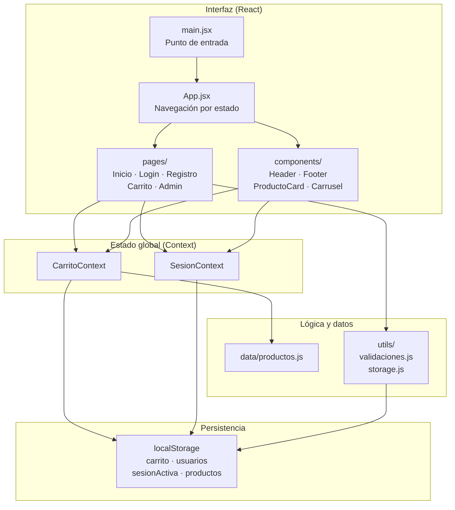

# Diagrama de Arquitectura — AkumaTech (React)

Organización por capas del proyecto migrado a React.

---

## Arquitectura general

---

## Relación con el proyecto original (JS → React)

| JavaScript vanilla | React |
|--------------------|-------|
| `index.html` + `body.js` | `pages/Inicio.jsx` + `CarritoContext` |
| `login.js` / `registro.js` | `pages/Login.jsx` / `pages/Registro.jsx` |
| `carrito.js` | `pages/Carrito.jsx` |
| `carrusel.js` | `components/Carrusel.jsx` |
| `admin*.js` | `pages/Admin*.jsx` |
| `style.css` | `src/index.css` |
| `localStorage` directo | `utils/storage.js` + Context |
