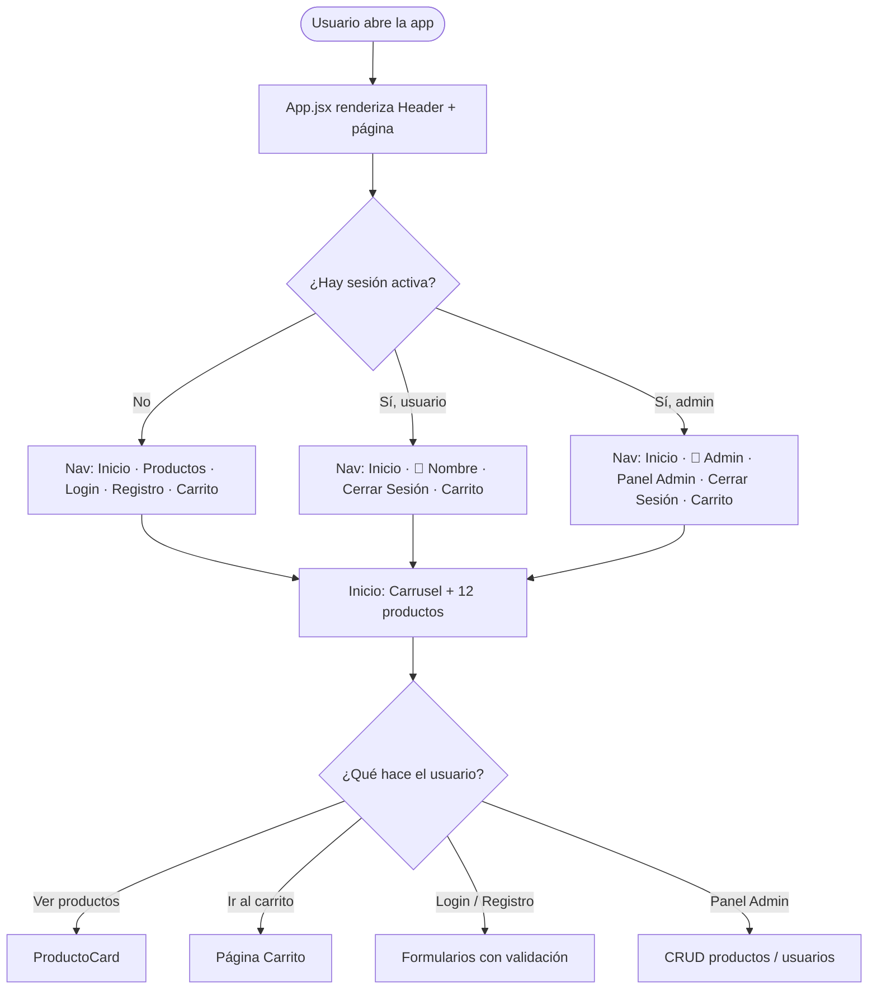
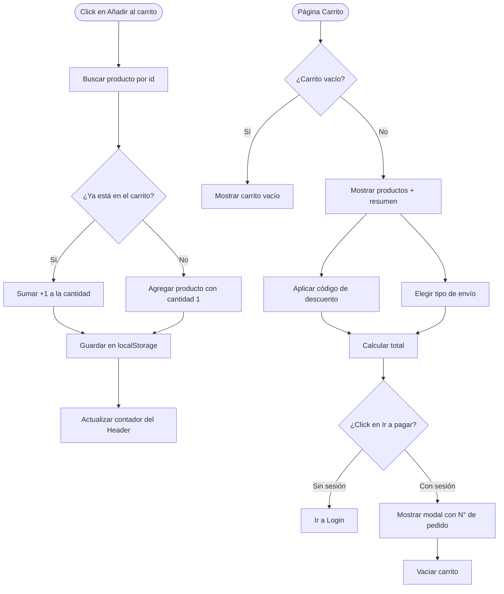
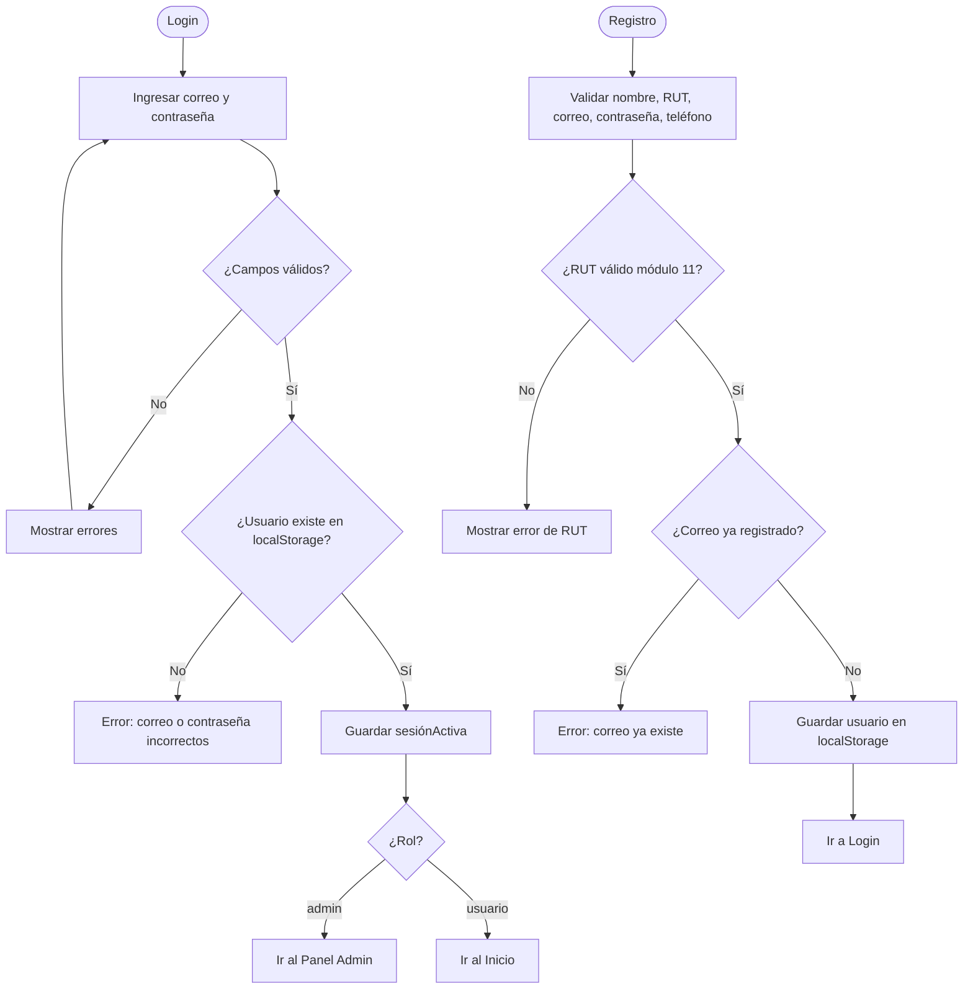

# Diagrama de Flujo — AkumaTech (React)

Flujos principales de la aplicación: navegación, carrito y autenticación.

---

## Flujo principal de navegación

---

## Flujo del carrito

---

## Flujo de autenticación

